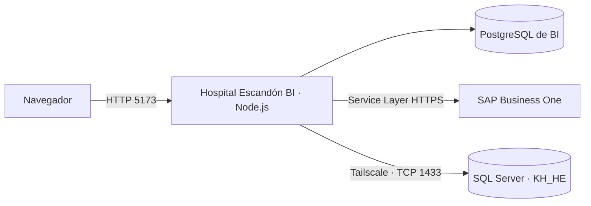

# Conexión de producción mediante Tailscale

Actualizado el 2 de octubre de 2026 para Hospital Escandón BI: backend Node.js/Express, frontend React y persistencia local PostgreSQL.

## Conexiones utilizadas

El backend consulta SQL Server de Vertical por la red privada de Tailscale. La conexión configurada es `100.121.115.8:1433`, base `KH_HE`. SAP utiliza su Service Layer por separado. PostgreSQL guarda la configuración y el histórico de BI.



## Preparar el servidor

1. Instala Tailscale desde [su sitio oficial](https://tailscale.com/download/windows) e inicia sesión con la cuenta autorizada por Sistemas para la red del hospital.
2. Comprueba que el servidor está conectado a esa red y que sus permisos permiten llegar al SQL Server. Mantén su conexión disponible tras reiniciar Windows según la configuración aprobada por Sistemas.
3. Conserva las credenciales existentes en `backend/.env`. El pase sólo incluye `.env.example`; los ejemplos siguientes no contienen claves utilizables.

El código actual utiliza estas variables:

```env
REMOTE_DB_SERVER=100.121.115.8
REMOTE_DB_PORT=1433
REMOTE_DB_NAME=KH_HE
REMOTE_DB_USER=USUARIO_AUTORIZADO
REMOTE_DB_PASS=CLAVE_CONFIGURADA_EN_EL_SERVIDOR

PGHOST=localhost
PGPORT=5432
PGDATABASE=escandon_bi
PGUSER=USUARIO_POSTGRESQL
PGPASSWORD=CLAVE_POSTGRESQL_DEL_SERVIDOR

NODE_ENV=production
PORT=5173
```

Para esta plataforma se usan `REMOTE_DB_*` y `PG*`. Los nombres antiguos `KH_*` y `DATABASE_URL` no configuran esas conexiones. La conexión SAP y sus credenciales deben conservarse como están en el servidor.

## Verificar la conexión

Desde PowerShell en el servidor:

```powershell
Test-NetConnection -ComputerName 100.121.115.8 -Port 1433
```

`TcpTestSucceeded` debe ser `True`. Esta comprobación confirma acceso de red; la autenticación y los permisos de lectura se comprueban después al abrir un tablero o reporte autorizado.

Inicia la plataforma con `iniciar_produccion.bat` y abre `http://localhost:5173/health`. Debe mostrar `status: ok`, `db: ok` y `environment: production`. El dato `db` comprueba PostgreSQL local; no representa por sí solo el estado de SAP ni Vertical.

Si falla el acceso remoto, revisa la conexión Tailscale, las reglas de acceso entre equipos, TCP 1433 y los permisos del usuario SQL Server. Las credenciales se revisan en el servidor; no deben copiarse al paquete de actualización ni a este documento.

Consulta [README_PRODUCCION.md](README_PRODUCCION.md) para aplicar el pase completo y conservar los datos existentes.
